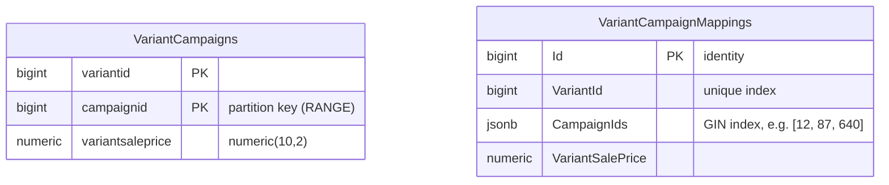

# DataPartitioningProject

An ASP.NET Core minimal API that compares two PostgreSQL layouts for "which variants are in campaign X?" queries: a range-partitioned relational table and a `jsonb` mapping table with a GIN index. An NBomber project load-tests the API.


## Overview

In e-commerce, a product variant can be in many campaigns, and a campaign can contain thousands of variants. Two lookups come up all the time:

- **campaign → variants**: list every variant (with its sale price) in a campaign
- **variant → campaigns**: list every campaign a variant is in

With millions of variants and an average of about 8 campaigns per variant, a single many-to-many table quickly reaches tens of millions of rows. This project stores the same data in two ways so you can compare them:

1. **`VariantCampaigns`**: one row per (variant, campaign) pair, **range-partitioned by `campaignid`** in PostgreSQL.
2. **`VariantCampaignMappings`**: one row per variant, with its campaign ids in a **`jsonb` array covered by a GIN index**.

## Data model and indexing



### Partitioned table: `VariantCampaigns`

The table is created with raw SQL in the `InitialCreate` migration, because EF Core cannot model partitioning:

```sql
CREATE TABLE "VariantCampaigns" (
    VariantId BIGINT,
    CampaignId BIGINT,
    VariantSalePrice DECIMAL(10,2),
    PRIMARY KEY (VariantId, CampaignId)
) PARTITION BY RANGE (CampaignId);
```

It has six partitions, each covering 200 campaign ids: `VariantCampaigns_1_200` (1–200), `VariantCampaigns_1_400` (201–400), and so on up to `VariantCampaigns_1_1200` (1001–1200). A query such as `WHERE campaignid = 42` is pruned to a single partition. Within that partition, a B-tree index on `campaignid` (migration `AddCampaignIndexes`) is needed, because the primary key starts with `variantid`. On a locally seeded database the plan looks like this:

```
Bitmap Heap Scan on "VariantCampaigns_1_200" "VariantCampaigns"
  Recheck Cond: (campaignid = 42)
  ->  Bitmap Index Scan on "VariantCampaigns_1_200_campaignid_idx"
```

### `jsonb` mapping table: `VariantCampaignMappings`

Each variant has a single row whose `CampaignIds` column holds a JSON array (EF Core value converter `List<long>` ↔ `jsonb`).

- **variant → campaigns** is a lookup on the unique `VariantId` index.
- **campaign → variants** is a containment query, `"CampaignIds" @> '[42]'`, which EF Core produces from `EF.Functions.JsonContains`. The GIN index `IX_VariantCampaignMappings_CampaignIds` serves it:

```
Bitmap Heap Scan on "VariantCampaignMappings"
  Recheck Cond: ("CampaignIds" @> '[42]'::jsonb)
  ->  Bitmap Index Scan on "IX_VariantCampaignMappings_CampaignIds"
```

## Tech stack

- .NET 9, ASP.NET Core minimal APIs
- EF Core 9 with Npgsql (`Npgsql.EntityFrameworkCore.PostgreSQL` 9.0.3)
- PostgreSQL (verified with the `postgres:17` Docker image)
- Bogus for generating test data
- NBomber 5.8.2 for load testing

## Project structure

```
DataPartitioningProject.sln
├── DataPartitioningProject.API/
│   ├── Contexts/AppDbContext.cs          # EF Core model, column names, jsonb converter, indexes
│   ├── Data/VariantCampaignDataSeeder.cs # Bogus seeder, runs at startup
│   ├── Entities/                         # VariantCampaign, VariantCampaignMapping
│   ├── Migrations/                       # InitialCreate (partitions, raw SQL) + AddCampaignIndexes
│   ├── Repositories/                     # EF Core queries
│   ├── Services/                         # Thin service layer used by the endpoints
│   ├── Program.cs                        # DI, seeding, endpoints
│   └── DataPartitioningProject.API.http  # Sample requests
└── NBomberLoadTest/
    ├── Program.cs                        # Load-test scenario
    └── reports/                          # Report from a previous run (HTML + log)
```

## Getting started

Prerequisites: .NET 9 SDK, Docker, and the EF Core CLI (`dotnet tool install --global dotnet-ef`).

**1. Start PostgreSQL.** The credentials match `appsettings.json`. They are for local development only.

```bash
docker run -d --name dpp-postgres \
  -e POSTGRES_USER=sa -e 'POSTGRES_PASSWORD=Your_password123' -e POSTGRES_DB=DataPartitioning \
  -p 5432:5432 postgres:17
```

If port 5432 is already taken, map another port (for example `-p 55432:5432`) and override the connection string:

```bash
export ConnectionStrings__PostgreSqlConnection='Host=localhost;Port=55432;Username=sa;Password=Your_password123;Database=DataPartitioning'
```

**2. Apply the migrations.** This creates the partitioned table, its partitions, the mapping table and the indexes.

```bash
cd DataPartitioningProject.API
dotnet ef database update
```

**3. Run the API.** It listens on `http://localhost:5187`.

```bash
dotnet run --launch-profile http
```

At startup, the seeder fills both tables if `VariantCampaignMappings` is empty. Each variant gets a random sale price and between 1 and 15 distinct campaigns out of 1–1000. Rows are written in batches of 50,000 variants. The default is **2,000,000 variants**, which is roughly 16 million rows in `VariantCampaigns`. Seeding that many rows through EF Core takes a long time, and the API does not accept requests until it finishes. For a quick try, reduce the count:

```bash
Seeding__VariantCount=100000 dotnet run --launch-profile http
```

## Endpoints

| Method | Route | Reads/writes | Notes |
|---|---|---|---|
| GET | `/variant-campaigns` | `VariantCampaigns` (partitioned) | Variants of a **random** campaign (1–1000). Used by the load test |
| GET | `/campaigns/{campaignId}/variants` | `VariantCampaigns` (partitioned) | Partition pruning + `campaignid` index |
| GET | `/campaigns/{campaignId}/variant-mappings` | `VariantCampaignMappings` | `jsonb @>` containment, uses the GIN index |
| GET | `/variants/{variantId}/campaigns` | `VariantCampaignMappings` | Returns the campaign id array of one variant |
| POST | `/variants/{variantId}/campaigns` | both tables | Adds a variant to a campaign. Idempotent |

```bash
curl http://localhost:5187/campaigns/42/variants
# [{"variantId":14,"campaignId":42,"variantSalePrice":322.39}, ...]

curl http://localhost:5187/campaigns/42/variant-mappings
# [{"id":14,"variantId":14,"campaignIds":[147,310,42],"variantSalePrice":322.387811306446890}, ...]

curl http://localhost:5187/variants/1/campaigns
# [601,716,308,159,60,646,758,482,542,365,707,45]

curl -X POST http://localhost:5187/variants/1/campaigns \
  -H 'Content-Type: application/json' \
  -d '{"campaignId": 1000, "salePrice": 99.90}'
# 204 No Content
```

`DataPartitioningProject.API.http` has the same requests for the VS Code REST Client and Rider/Visual Studio. The sample responses above are from a locally seeded database, so your ids will differ.

## Load testing

The `NBomberLoadTest` project runs a single scenario: 100 concurrent copies call `GET http://localhost:5187/variant-campaigns` for 60 seconds, after NBomber's default 30-second warm-up. Start the API first, then run:

```bash
cd NBomberLoadTest
dotnet run
```

NBomber writes an HTML report to `reports/` under the working directory.

### Committed result (7 February 2025)

`NBomberLoadTest/reports/nbomber_report_2025-02-07--09-36-55.html` holds one earlier run.

| Metric | Value |
|---|---|
| Requests | 485 OK, 0 failed |
| Throughput | 8.1 RPS |
| Latency mean / p50 | 12,730 ms / 11,805 ms |
| Latency p75 / p95 / p99 | 14,139 ms / 23,708 ms / 25,117 ms |
| Data transferred | ~498 MB total (~1 MB per response) |

**Run conditions:**

- Everything ran on one developer machine (macOS, 12 cores, .NET 9): the API, PostgreSQL and NBomber.
- The run used the endpoint and schema **as they were at that commit**, before the `campaignid` index was added. Each campaign lookup therefore scanned a whole 200-campaign partition.
- Each response returns every variant of a campaign, about 1 MB of JSON.
- The API logs every SQL command to the console.

These numbers are a baseline for that setup. They are not a benchmark of the current code, which has not been re-measured.

## Design notes and trade-offs

- **Partitioning by campaign range** keeps each campaign lookup inside one partition, and old campaign ranges can be detached or dropped cheaply. Partitions must exist before data arrives, though: here they are fixed at 1–1200.
- **The primary key `(variantid, campaignid)`** must include the partition key, as PostgreSQL requires. Because `variantid` comes first, the key does not help campaign lookups, hence the separate `campaignid` index.
- **The `jsonb` + GIN layout** stores one row per variant, so variant → campaigns is a single-row read and the table is about 8× smaller in rows. Campaign → variants depends on the GIN index, and every write rewrites the whole array.
- **The two tables are kept in sync by the application** (seeder and `AddVariantToCampaign`), not by the database. The POST endpoint writes them in two separate `SaveChanges` calls, without a shared transaction.
- **Seeding uses EF Core `AddRange` in batches**, which is easy to read but much slower than `COPY` / `NpgsqlBinaryImporter` for millions of rows.

## Known limitations

- Campaign ids outside 1–1200 have no partition, so inserting them fails. There is no default partition, and the POST endpoint returns 500.
- The campaign → variants endpoints return every matching row, with no pagination.
- Seeding runs inside application startup and blocks it.
- The development database credentials are committed in `appsettings*.json`, and `MaxPoolSize=5000` is far above PostgreSQL's default `max_connections` (100).
- EF Core SQL logging to the console (`LogTo(Console.WriteLine)`) is always on, which adds overhead under load.
- There are no automated tests. The load test URL is hard-coded to `http://localhost:5187`.
