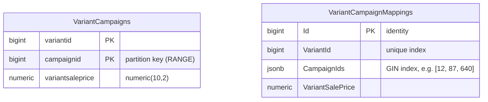

# DataPartitioningProject

An ASP.NET Core minimal API that compares two PostgreSQL layouts for "which variants are in campaign X?" queries: a range-partitioned relational table and a `jsonb` mapping table with a GIN index. An NBomber project load-tests the API.


## Overview

In e-commerce, a product variant can be in many campaigns, and a campaign can contain thousands of variants. Two lookups come up all the time:

- **campaign → variants**: list every variant (with its sale price) in a campaign
- **variant → campaigns**: list every campaign a variant is in

With millions of variants and an average of about 8 campaigns per variant, a single many-to-many table quickly reaches tens of millions of rows. This project stores the same data in two ways so you can compare them:

1. **`VariantCampaigns`**: one row per (variant, campaign) pair, **range-partitioned by `campaignid`** in PostgreSQL.
2. **`VariantCampaignMappings`**: one row per variant, with its campaign ids in a **`jsonb` array covered by a GIN index**.

## Data model and indexing



### Partitioned table: `VariantCampaigns`

The table is created with raw SQL in the `InitialCreate` migration, because EF Core cannot model partitioning:

```sql
CREATE TABLE "VariantCampaigns" (
    VariantId BIGINT,
    CampaignId BIGINT,
    VariantSalePrice DECIMAL(10,2),
    PRIMARY KEY (VariantId, CampaignId)
) PARTITION BY RANGE (CampaignId);
```

It has six partitions, each covering 200 campaign ids: `VariantCampaigns_1_200` (1–200), `VariantCampaigns_1_400` (201–400), and so on up to `VariantCampaigns_1_1200` (1001–1200). A query such as `WHERE campaignid = 42` is pruned to a single partition. Within that partition, a B-tree index on `campaignid` (migration `AddCampaignIndexes`) is needed, because the primary key starts with `variantid`. On a locally seeded database the plan looks like this:

```
Bitmap Heap Scan on "VariantCampaigns_1_200" "VariantCampaigns"
  Recheck Cond: (campaignid = 42)
  ->  Bitmap Index Scan on "VariantCampaigns_1_200_campaignid_idx"
```

### `jsonb` mapping table: `VariantCampaignMappings`

Each variant has a single row whose `CampaignIds` column holds a JSON array (EF Core value converter `List<long>` ↔ `jsonb`).

- **variant → campaigns** is a lookup on the unique `VariantId` index.
- **campaign → variants** is a containment query, `"CampaignIds" @> '[42]'`, which EF Core produces from `EF.Functions.JsonContains`. The GIN index `IX_VariantCampaignMappings_CampaignIds` serves it:

```
Bitmap Heap Scan on "VariantCampaignMappings"
  Recheck Cond: ("CampaignIds" @> '[42]'::jsonb)
  ->  Bitmap Index Scan on "IX_VariantCampaignMappings_CampaignIds"
```

## Tech stack

- .NET 10 (LTS), ASP.NET Core minimal APIs
- EF Core 10 with Npgsql (`Npgsql.EntityFrameworkCore.PostgreSQL` 10.0.3)
- PostgreSQL (verified with the `postgres:17` Docker image)
- Bogus for generating test data
- NBomber 6.7 for load testing (free for personal use; organizations need an NBomber license)

## Project structure

```
DataPartitioningProject.sln
├── DataPartitioningProject.API/
│   ├── Contexts/AppDbContext.cs          # EF Core model, column names, jsonb converter, indexes
│   ├── Data/VariantCampaignDataSeeder.cs # Bogus seeder, runs at startup
│   ├── Entities/                         # VariantCampaign, VariantCampaignMapping
│   ├── Migrations/                       # InitialCreate (partitions, raw SQL) + AddCampaignIndexes
│   ├── Repositories/                     # EF Core queries
│   ├── Services/                         # Thin service layer used by the endpoints
│   ├── Program.cs                        # DI, seeding, endpoints
│   └── DataPartitioningProject.API.http  # Sample requests
├── NBomberLoadTest/
│   ├── Program.cs                        # Load-test scenario (configurable through environment variables)
│   └── reports/                          # Reports of the runs quoted below (HTML, Markdown, log)
├── Dockerfile                            # Multi-stage build of the API
├── docker-compose.yml                    # PostgreSQL 17 + the API
└── .config/dotnet-tools.json             # Pins dotnet-ef 10
```

## Getting started

Prerequisites: .NET 10 SDK and Docker. The EF Core CLI is pinned in a local tool manifest; restore it once with `dotnet tool restore`.

### Option A: everything in Docker

```bash
docker compose up --build
```

This starts PostgreSQL 17 and the API on `http://localhost:5187`. The API applies the migrations at startup (`Database__MigrateOnStartup=true`) and seeds **100,000 variants** by default; set `SEED_VARIANT_COUNT` to change it. Host ports can be changed with `POSTGRES_PORT` and `API_PORT`:

```bash
SEED_VARIANT_COUNT=500000 API_PORT=8080 docker compose up --build
```

`docker compose down -v` stops the stack and deletes the database volume.

### Option B: API on the host, PostgreSQL in Docker

**1. Start PostgreSQL.** The credentials match `appsettings.json`. They are for local development only.

```bash
docker run -d --name dpp-postgres \
  -e POSTGRES_USER=sa -e 'POSTGRES_PASSWORD=Your_password123' -e POSTGRES_DB=DataPartitioning \
  -p 5432:5432 postgres:17
```

If port 5432 is already taken, map another port (for example `-p 55432:5432`) and override the connection string:

```bash
export ConnectionStrings__PostgreSqlConnection='Host=localhost;Port=55432;Username=sa;Password=Your_password123;Database=DataPartitioning;MaxPoolSize=50'
```

**2. Apply the migrations.** This creates the partitioned table, its partitions, the mapping table and the indexes.

```bash
dotnet tool restore
cd DataPartitioningProject.API
dotnet ef database update
```

**3. Run the API.** It listens on `http://localhost:5187`.

```bash
dotnet run --launch-profile http
```

At startup, the seeder fills both tables if `VariantCampaignMappings` is empty. Each variant gets a random sale price and between 1 and 15 distinct campaigns out of 1–1000. Rows are written in batches of 50,000 variants. The default is **2,000,000 variants**, which is roughly 16 million rows in `VariantCampaigns`. Seeding that many rows through EF Core takes a long time, and the API does not accept requests until it finishes. For a quick try, reduce the count:

```bash
Seeding__VariantCount=100000 dotnet run --launch-profile http
```

## Endpoints

| Method | Route | Reads/writes | Notes |
|---|---|---|---|
| GET | `/variant-campaigns` | `VariantCampaigns` (partitioned) | Variants of a **random** campaign (1–1000). Used by the load test |
| GET | `/campaigns/{campaignId}/variants` | `VariantCampaigns` (partitioned) | Partition pruning + `campaignid` index |
| GET | `/campaigns/{campaignId}/variant-mappings` | `VariantCampaignMappings` | `jsonb @>` containment, uses the GIN index |
| GET | `/variants/{variantId}/campaigns` | `VariantCampaignMappings` | Returns the campaign id array of one variant |
| POST | `/variants/{variantId}/campaigns` | both tables | Adds a variant to a campaign. Idempotent |

```bash
curl http://localhost:5187/campaigns/42/variants
# [{"variantId":14,"campaignId":42,"variantSalePrice":322.39}, ...]

curl http://localhost:5187/campaigns/42/variant-mappings
# [{"id":14,"variantId":14,"campaignIds":[147,310,42],"variantSalePrice":322.387811306446890}, ...]

curl http://localhost:5187/variants/1/campaigns
# [601,716,308,159,60,646,758,482,542,365,707,45]

curl -X POST http://localhost:5187/variants/1/campaigns \
  -H 'Content-Type: application/json' \
  -d '{"campaignId": 1000, "salePrice": 99.90}'
# 204 No Content
```

`DataPartitioningProject.API.http` has the same requests for the VS Code REST Client and Rider/Visual Studio. The sample responses above are from a locally seeded database, so your ids will differ.

## Load testing

The `NBomberLoadTest` project runs a single scenario: a constant number of concurrent copies call `GET /variant-campaigns` (variants of a random campaign, read from the partitioned table) after a warm-up. Each request reads the whole response body, so the latency includes the transfer. Start the API first, then run:

```bash
cd NBomberLoadTest
dotnet run -c Release
```

The defaults are 100 copies, 60 seconds and a 30-second warm-up against `http://localhost:5187`. They can be changed with environment variables:

| Variable | Default |
|---|---|
| `LOADTEST_BASE_URL` | `http://localhost:5187` |
| `LOADTEST_PATH` | `/variant-campaigns` |
| `LOADTEST_COPIES` | `100` |
| `LOADTEST_DURATION_SECONDS` | `60` |
| `LOADTEST_WARMUP_SECONDS` | `30` |

NBomber writes HTML and Markdown reports and a log to `reports/` under the working directory.

### Results

The two runs below used different code, data volumes and response sizes, so they are **not a like-for-like comparison**. Read each one with its conditions.

| | Run 1: 7 Feb 2025 (baseline) | Run 2: 23 Oct 2026 (current code) |
|---|---|---|
| Code | .NET 9, before the `campaignid` index | .NET 10, with the `campaignid` index (`AddCampaignIndexes`) |
| SQL logging | Every command logged to the console | Off (`Database.Command` category at `Warning`) |
| Npgsql pool | `MaxPoolSize=5000` | `MaxPoolSize=50` |
| Data | 2,000,000 variants, ~16 M rows in `VariantCampaigns` | 500,000 variants, ~4 M rows in `VariantCampaigns` |
| Response size | ~1 MB (~16,000 rows per campaign) | ~248 KB (~4,000 rows per campaign) |
| Load | 100 copies, 60 s, 30 s warm-up | 100 copies, 60 s, 30 s warm-up |
| Requests | 485 OK, 0 failed | 32,886 OK, 0 failed |
| Throughput | 8.1 RPS | 548 RPS |
| Latency mean / p50 | 12,730 ms / 11,805 ms | 182 ms / 173 ms |
| Latency p75 / p95 / p99 | 14,139 ms / 23,708 ms / 25,117 ms | 213 ms / 279 ms / 377 ms |
| Data transferred | ~498 MB | ~7.97 GB |
| Report | `reports/nbomber_report_2025-02-07--09-36-55.html` | `reports/nbomber_report_2026-10-23--07-21-20.html` (and `.md`) |

**Conditions of run 2:** one Apple M2 Pro laptop (12 cores, macOS) ran everything. The API ran on the host as a Release build (`dotnet bin/Release/net10.0/DataPartitioningProject.API.dll`, Development environment), PostgreSQL 17 ran in Docker Desktop (12 CPUs, 8 GB for the VM) with default settings after `VACUUM ANALYZE`, and NBomber ran on the same machine. The data set had 500,000 variants: a 2 M-variant seed was started but stopped after its 500,000th variant, because the Docker disk on that machine was too small for the full set. The seeder commits in batches of 50,000 variants, so this is the same shape of data a `Seeding__VariantCount=500000` run produces. The query plan used the partition's `campaignid` index (see [Partitioned table](#partitioned-table-variantcampaigns)).

Because the data volume and payload are 4× smaller in run 2, part of the improvement comes from moving less data per request. The index (no full-partition scan) and the removal of per-command console logging account for the rest; this run does not separate the two effects. To reproduce run 2:

```bash
SEED_VARIANT_COUNT=500000 POSTGRES_PORT=55432 docker compose up -d --build
docker compose logs -f api   # wait until seeding has finished, then Ctrl+C
docker compose stop api
export ConnectionStrings__PostgreSqlConnection='Host=localhost;Port=55432;Username=sa;Password=Your_password123;Database=DataPartitioning;SSL Mode=Disable;Pooling=true;MinPoolSize=5;MaxPoolSize=50;Timeout=15;'
dotnet build -c Release DataPartitioningProject.API
ASPNETCORE_URLS=http://localhost:5187 dotnet DataPartitioningProject.API/bin/Release/net10.0/DataPartitioningProject.API.dll &
cd NBomberLoadTest && dotnet run -c Release
```

## Design notes and trade-offs

- **Partitioning by campaign range** keeps each campaign lookup inside one partition, and old campaign ranges can be detached or dropped cheaply. Partitions must exist before data arrives, though: here they are fixed at 1–1200.
- **The primary key `(variantid, campaignid)`** must include the partition key, as PostgreSQL requires. Because `variantid` comes first, the key does not help campaign lookups, hence the separate `campaignid` index.
- **The `jsonb` + GIN layout** stores one row per variant, so variant → campaigns is a single-row read and the table is about 8× smaller in rows. Campaign → variants depends on the GIN index, and every write rewrites the whole array.
- **The two tables are kept in sync by the application** (seeder and `AddVariantToCampaign`), not by the database. The POST endpoint writes them in two separate `SaveChanges` calls, without a shared transaction.
- **Seeding uses EF Core `AddRange` in batches**, which is easy to read but much slower than `COPY` / `NpgsqlBinaryImporter` for millions of rows.

## Configuration notes

- **SQL logging.** EF Core logs SQL through the standard logging pipeline under the `Microsoft.EntityFrameworkCore.Database.Command` category, which is set to `Warning` in `appsettings*.json`, so commands are not logged. To see them, raise the level, for example `Logging__LogLevel__Microsoft.EntityFrameworkCore.Database.Command=Information dotnet run`. Leave it off for load tests.
- **Connection pool.** The connection string uses `MaxPoolSize=50`. PostgreSQL accepts 100 connections by default (`max_connections`), so a pool larger than that only lets the API exhaust the server under load. With a pool of 50, extra requests wait up to `Timeout=15` seconds for a free connection. If you run several API instances, keep the sum of their pools below `max_connections` (or put PgBouncer in front).
- **Docker.** The compose file disables GSS encryption negotiation (`Gss Encryption Mode=Disable`), because the ASP.NET base image has no Kerberos library.

## Known limitations

- Campaign ids outside 1–1200 have no partition, so inserting them fails. There is no default partition, and the POST endpoint returns 500.
- The campaign → variants endpoints return every matching row, with no pagination.
- Seeding runs inside application startup and blocks it. It uses EF Core `AddRange`, which is slow for millions of rows (`COPY` would be much faster).
- The development database credentials are placeholders committed in `appsettings*.json` and `docker-compose.yml`.
- There are no automated tests.

## License

[MIT](LICENSE) © 2025 Gökhan Ertoğan
